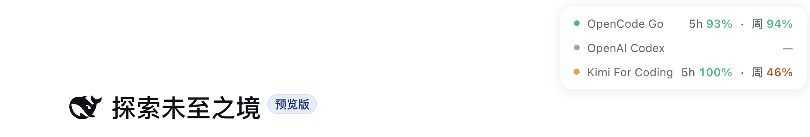

# dsh-plugin-llm-balance

> 🏷️ **DSH 官方插件生态**收录项目（git tag: `dsh-official-plugin`；GitHub topics: `dsh-plugin` · `deepseek-harness`）。
>
> [English](README.en.md) | 中文

DSH（DeepSeek Harness）的余额与配额悬浮卡片。它会在 Web GUI 中常驻显示最近使用的最多 3 个 provider，让余额、套餐余量和重置时间一眼可见。



## 功能

- **自动跟随最近使用的 provider**：只记录插件启用后成功完成的模型调用，显示最近 3 个不同 provider；已有项目保持槽位稳定，新项目只替换被淘汰项。
- **同时支持余额与配额**：金额余额按数值显示；套餐配额同时展示 5 小时、周等可用窗口及重置时间，状态颜色按最紧张的窗口计算。
- **DeepSeek 峰谷电价徽标**：DeepSeek 余额行尾部显示「☾ 低谷 / ☀ 高峰」小药丸——2026-08-17 起高峰为北京时间每日 09:00–12:00、14:00–18:00，含午间 12:00–14:00 在内的其余时段均为低谷半价；纯时钟计算不发请求，tooltip 显示时段表与距切换的倒计时，徽标随现有余额轮询及标签页恢复刷新；未配置 Key 的行不挂徽标。
- **自动发现配置**：合并内置 provider、`llm-pi-ai.providers.*` 和本插件配置，无需逐个添加。
- **轻量交互**：卡片可拖动并记忆位置；点击即可刷新；默认每 60 秒自动刷新，页面隐藏时暂停、恢复可见时立即更新。
- **凭据不出服务端**：API Key 和 OAuth token 不会发送到浏览器；DSH 0.1.1 使用 loopback-only RPC，0.1.2 使用其统一 BrowserAuth。

### 支持范围

| Provider | 展示内容 | 凭据来源 |
|---|---|---|
| DeepSeek / DeepSeek Official | CNY 余额 | DSH credentials |
| Moonshot / Moonshot CN | CNY 余额 | DSH credentials |
| Kimi For Coding | 5h、周配额与套餐等级 | DSH credentials |
| OpenAI Codex | 5h、周、可选月配额与 Credits | Codex Connect 的 ChatGPT OAuth |
| OpenCode Go | 5h、周配额 | DSH credentials |
| OpenRouter | API Key 日/周/月消费限额 | DSH credentials |
| MiniMax / MiniMax CN | Token Plan 5h、周配额 | DSH credentials |
| Z.AI / BigModel | Coding Plan 5h、周配额 | DSH credentials |

余额颜色：绿 `>=100`，黄 `20–99`，红 `1–19`，灰 `<1`。配额颜色：绿 `>=50%`，黄 `20–49%`，红 `5–19%`，灰 `<5%`；加载或查询失败同样显示灰色。

## 原理

- **服务端**（`lib/index.js`）：记录最近使用的 provider，通过 Connection RPC 代理余额查询，从显式 `apiKeyEnv` 或 `llm-pi-ai/<provider>` API-key record 取凭据，并对同源请求去重；OAuth grant 只判断已配置，不解析内容。
- **浏览器端**（`lib/client.js`）：聚合最近 3 个 provider，只请求当前需要展示的数据，并负责刷新、着色、拖动和位置记忆。
- **支持的 provider 接口**：

  | provider id | 接口 | 口径 |
  |---|---|---|
  | deepseek / deepseek-official | `GET https://api.deepseek.com/user/balance` | 余额（CNY；官方 `total_balance` 为字符串，数字同样兼容） |
  | moonshotai / moonshotai-cn | `GET https://api.moonshot.ai/v1/users/me/balance` / `https://api.moonshot.cn/...` | 国际/CN 余额（CNY） |
  | kimi-coding | `GET https://api.kimi.com/coding/v1/usages` | 套餐配额（顶层 usage=周限额 + limits 窗口明细（5h 限流等，window 对象归一化为 5h/周），含套餐等级） |
  | openai-codex | `dsh-codex-connect`（`GET https://chatgpt.com/backend-api/wham/usage`） | Codex Connect 配额（rateLimits 主 bucket（id `codex`，回退首个）窗口 = 剩余百分比（limit=100，18000s → 5h、604800s → 周，其余稳定时长标签）；可选 individualLimit → 月配额、credits → USD 余额或 Credits 段（`credits.unlimited=true` 时仅因百分比 UI 显示为有限 100/100——绿色 100% 而非灰色 ∞/∞，账户本身仍无限）） |
  | opencode-go | `GET https://opencode.ai/zen/go/v1/usage` | OpenCode Go 套餐配额（`usage.rolling` → 5h、`usage.weekly` → 周：`percent` 为已用百分比 → amount=100-percent、limit=100，`resetsAt` → 重置时间；monthly 忽略；单个窗口无效只跳过该窗口，至少一个窗口有效才成功。⚠️ 端点目前无官方公开文档，可能变化） |
  | openrouter | `GET https://openrouter.ai/api/v1/key` | 当前 Key 的日/周/月消费限额；Key 未设限时如实报告无剩余额度口径 |
  | minimax / minimax-cn | `GET https://www.minimax.io/v1/token_plan/remains` / `https://www.minimaxi.com/...` | Token Plan 文本模型 5h、周剩余比例 |
  | zai / zai-coding-cn | `GET https://api.z.ai/api/monitor/usage/quota/limit` / `https://open.bigmodel.cn/...` | Coding Plan 5h、周剩余比例；忽略 MCP/tool-only 月额度 |

  llm-pi-ai 中声明的其他路由若无内置接口表，如实报告 `no_balance_api`，不误报配置错误。

### OpenAI Codex（Codex Connect，可选）

- **前置条件**：若要显示配额，单独安装并启用 [dsh-codex-connect](https://github.com/franksong2702/dsh-codex-connect)（`dsh plugin --profile web add dsh-codex-connect@alpha`，最低兼容 `0.1.0-alpha.4.5`），并在其界面完成 ChatGPT OAuth 登录。本插件把它声明为**可选 peer 依赖**；只有 DSH 原生 Codex OAuth 时会显示“已登录 DSH，配额查询需 Codex Connect”。
- **无 API Key**：Codex 走 ChatGPT OAuth，不需要 `DEEPSEEK_API_KEY` 之类的凭证；登录态与配额查询全部经由 codex-connect 的 `OpenAICodexCredentialStore` 封装完成。本插件在 `openai-codex` 被查询时才**动态 import** codex-connect；模块缺失/不兼容或未登录 → `configured:false`（安全 ref，不含凭据）；已登录但配额查询失败 → `status:error / error:unavailable`；成功 → 把无密钥的 `OpenAICodexUsage` 映射为现有 quota 口径。
- **显示**：5h/周限额以剩余百分比呈现（如 `5h 74% · 周 68%`）；若账户有月支出上限则追加「月」窗口；无限额度账户（`credits.unlimited=true`）显示「Credits」段——仅因现有百分比 UI 才以有限 100/100 呈现（绿色 100% 而非灰色 ∞/∞），账户本身仍无限。
- **安全**：本插件**从不直接读取或复制** OAuth 文档（`.openai-codex-auth.json`），token 不会出现在任何响应、日志或页面中。

## 安装

本插件是**官方 bundle 形态**（`dsh.bundle.patch` 声明激活层 + `dsh.client` 声明浏览器半身，
见[官方打包文档](https://github.com/deepseek-ai/deepseek-harness/blob/master/docs/user/develop/basic/publish.md)），
`dsh plugin add` 一条命令即可安装并激活（自动加入 profile 的 bundles 层，无需手改任何文件）：

需要 DSH `0.1.1-rc.2` 至 `0.1.2-alpha.4`；前者使用 loopback RPC，后者使用 BrowserAuth RPC。

```bash
# 方式 A（推荐）：从 npm 安装（发布后）
dsh plugin --profile web add dsh-plugin-llm-balance

# 方式 B：从 GitHub 安装（源码 checkout，无需构建）
dsh plugin --profile web add "github:FengHuoLinShan/dsh-plugin-llm-balance#main"

# 方式 C（本地开发）：从 checkout 安装
dsh plugin --profile web add /path/to/dsh-plugin-llm-balance

# 方式 D（备选，任意版本）：tarball 安装
dsh plugin --profile web add ./dsh-plugin-llm-balance-0.3.0.tgz
```

装完**重启 dsh 服务**（插件集合变更需重启生效；此后改动 client bundle 仅在 DSH checkout 的 `pnpm run dev:web` watcher 运行时走 HMR 自动热更，否则需重新安装/重启服务并刷新页面），
刷新页面即可看到右上角悬浮卡片。

> 需要显示 **OpenAI Codex** 时，另装 Codex Connect（可选）：
>
> ```bash
> dsh plugin --profile web add dsh-codex-connect@alpha   # 最低兼容 0.1.0-alpha.4.5
> ```
>
> 装好后在其界面完成 ChatGPT OAuth 登录即可；不装也不影响本插件其他 provider。

> 个性化配置（如轮询间隔）在 `~/.dsh/profiles/web/cordis.patch.yml` 中按行 id 覆盖：
>
> ```yaml
> - update:
>     - id: llm-balance
>       config:
>         refreshMs: 30000
> ```
>
> 覆盖时需完整重述该行需要的全部 config 键（patch 按行整体替换 config，不做深合并）。

## 配置（cordis.patch.yml 中该行的 config）

| 字段 | 默认值 | 说明 |
|---|---|---|
| refreshMs | 60000 | 前端轮询间隔（毫秒） |
| timeoutMs | 15000 | 服务端查询超时（毫秒） |
| provider | deepseek | （兼容层）单 provider 模式；多 provider 模式无需设置，自动发现 |
| apiKeyEnv | DEEPSEEK_API_KEY | （兼容层）单 provider 模式的凭证引用名 |
| baseURL | 按 provider 默认 | （兼容层）单 provider 模式的可选 base URL 覆盖 |

多 provider 模式开箱即用：provider 清单来自内置表 + `llm-pi-ai` settings；显式 `apiKeyEnv` 只解析该引用，否则优先读取 `llm-pi-ai/<provider>` API-key record，再回退 provider 默认环境变量。OAuth grant 不被解析；`openai-codex` 配额由 Codex Connect 管理。

> 旧的单 provider 写法（`provider` + `apiKeyEnv`）继续兼容：RPC 响应顶层字段仍按 config.provider 条目返回。

所有字段均为宽松校验：`refreshMs` / `timeoutMs` 非数字或非正数、`provider` / `apiKeyEnv` 非字符串或空串、`baseURL` 非字符串，一律回退默认值，不会导致插件启动失败（零依赖实现 `normalizeConfig`，语义等价于官方 Config schema 的非法值回退）。

## 自测

```bash
node test/balance.test.mjs   # host 半身逻辑自测（桩 ctx + 桩 fetch）
```

## 卸载

```bash
dsh plugin --profile web remove dsh-plugin-llm-balance   # 移除依赖与 bundles 层
```

（旧的手动安装：删除 cordis.patch.yml 中对应行 + 删除软链，重启即可。）

## 发布与市场收录

- **npm**：`npm publish`（需先 `npm login`）。包已声明 `publishConfig.access: public`、
  `files` 白名单（lib/ + cordis.patch.yml + README/LICENSE）与完整开源元数据
  （repository / homepage / keywords / license）。
- **GitHub 收录标记**：仓库 topics 已带 `dsh-plugin` · `deepseek-harness` · `dsh-official-plugin`，
  git tag `dsh-official-plugin` 标记「DSH 官方插件生态」收录状态。
- **社区市场**：已收录于 [awesome-dsh-plugin](https://github.com/awesome-dsh-plugin/awesome-dsh-plugin)
  （dsh-market 插件市场的数据源）。其他可同步提交：
  [awesome-deepseek-harness](https://github.com/0xsline/awesome-deepseek-harness)、
  [dshfind](https://github.com/hikariming/dshfind)。

## 安全说明

- API Key 只在服务端解析与使用，不出现在任何响应、日志或页面中。
- 余额接口由服务端代理（同源），不受浏览器 CORS 限制，也不暴露 Key。
- **OpenAI Codex 无 API Key**：配额读取经由 `dsh-codex-connect` 的 `OpenAICodexCredentialStore` 封装；DSH 原生 `llm-pi-ai` grant 只用于判断已登录，本插件不解析、复制或刷新其 OAuth payload。
- 余额/配额数据来自官方接口，可能略有延迟，仅供参考。
- **信任边界**：余额查询使用 `/llm-balance` Connection RPC。DSH 0.1.1 以 `authority: "loopback"` 注册；0.1.2 的两参数 RPC 由宿主统一 BrowserAuth，在进入插件 handler 前完成认证。
